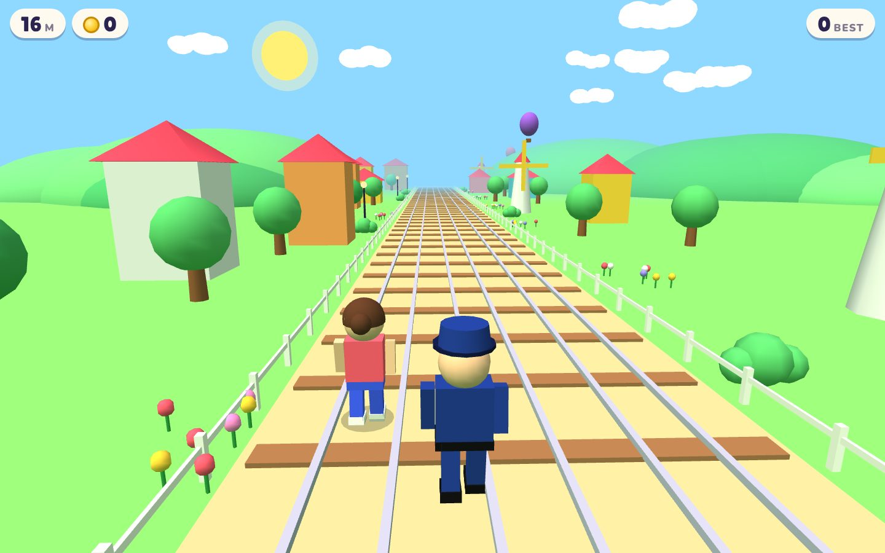

# Hop Hop Runner

A jump-only 3D endless runner for kids, inspired by Subway Surfers but with no ducking. Hop over everything, swerve round the trains, grab the coins, and jump through portals into new lands.

## How to play

- **Swipe left / right** (or arrow keys) to change lanes.
- **Tap or swipe up** (or space / up arrow) to jump.
- Bounce pads and ramps launch you up onto bridges, and big climbs take you higher and higher before a long slide down.
- Tall trains can't be jumped, so swerve round them.
- Run through tunnels with rainbow lights, twirl on big jumps, and get a cheer every 100 m.
- Bump into too many things and the policeman catches you!
- Grab a hoverboard to ride for 20 seconds; it saves you from one bump.
- Grab a magnet and coins fly to you for 15 seconds.
- Hit a mystery box for a surprise: coins, a hoverboard, a magnet, a zoom or a super jump.
- Golden speed portals zoom you along at top speed and dodge everything for you.
- Billboards beside the track show Robyn and cheer her on ("Well done Robyn!").
- The game starts a little quicker and the hoverboard is faster. If she keeps getting caught early, it gently slows down next time, and speeds back up after a good long run.
- Long rows of shops line the track right up to the fences, with gaps to see the trees and billboards, with bunting and fans waving from balconies. Fireworks go off in the sky, and wiggly coin trails weave across the lanes.
- Some trains have a ramp at the front: run up it and along the roof to grab the coins on top. Trains are 2 to 5 carriages long.
- Families of ducks waddle across the tracks now and then. They quack and flap out of the way, so they never trip her up.
- Little 3D cottages stand in the gaps between the shops.
- Sound effects are made in the browser; tap "Sound on" to mute. (On iPad, the side switch or Control Centre silent mode also mutes it.)

Works on iPad and phones. In Safari, use Share > Add to Home Screen to play it full screen like an app.

## Running it

It's a single `index.html` file with no build step. three.js loads from a CDN. Open the file in a browser, or serve the folder with any static host (for example GitHub Pages).

## Credits

- Cottage model: ["Painterly Cottage"](https://sketchfab.com/3d-models/painterly-cottage-0772aec70d584c60a27000af5f6c1ef4) by [glenatron](https://sketchfab.com/glenatron), licensed [CC BY-NC 4.0](http://creativecommons.org/licenses/by-nc/4.0/). Stored at `models/cottage.glb`.
